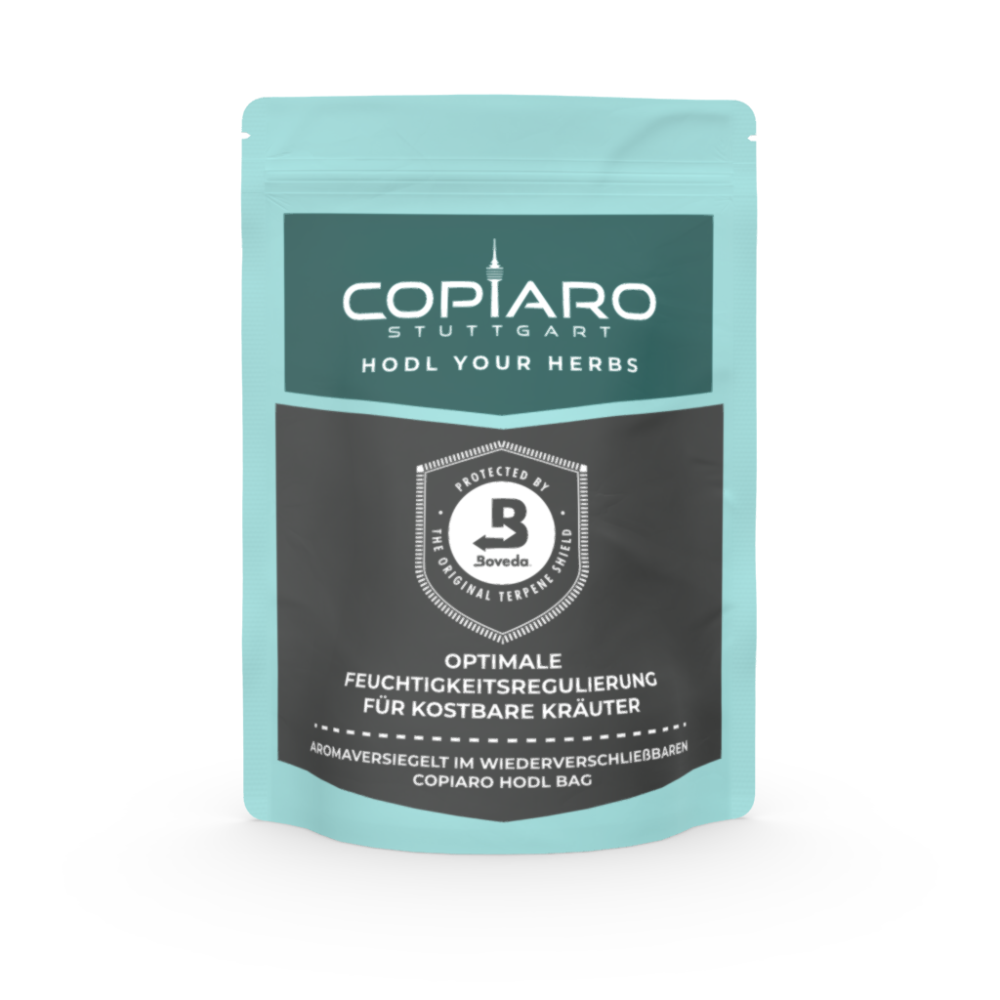
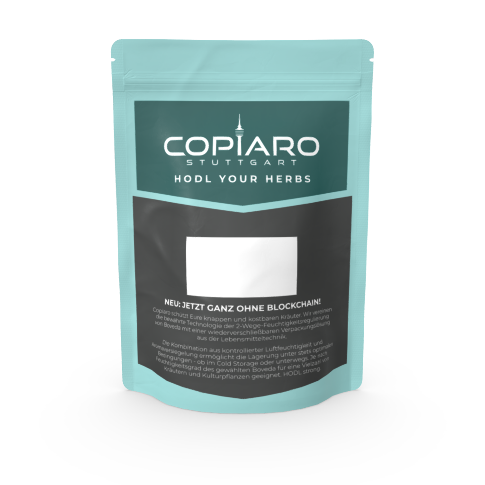

# v1.1 · HODL Bag (2021)

The **Copiaro HODL Bag** is a resealable, aroma-tight stand-up pouch for storing
herbs, co-branded with [Boveda](https://bovedainc.com) 2-way humidity control.
It has been in production since 2021 and is a long-standing companion of the
HODL your Herb booklet at Bitcoin events.

## Files

| Folder | File | Description |
|--------|------|-------------|
| `source/` | `hodl-bag_2021.svg` | Editable vector artwork incl. keylines, text converted to outlines |
| `print-ready/` | `hodl-bag_2021.pdf` | Final print file as used in production |
| `preview/` | `hodl-bag_2021_front.png`, `hodl-bag_2021_back.png` | 3D mockups |
| `preview/` | `hodl-bag_2021_flat.png` | Flat artwork with keylines |

## Print notes

- Pouch: stand-up pouch with zip lock, metallised film, size L
- Flat artwork: 530 × 160 mm, CMYK
- The print-ready PDF has three layers: `Artwork`, `Keylines` and `bila-white`
  (white underprint on metallised film). Most PDF viewers show the white layer as a
  solid blue area on top. Hide the `bila-white` layer to see the artwork.
- The white box on the back is the space for the barcode label.
- Fonts used: Futura Bold Condensed BT and Montserrat
  ([SIL Open Font License](https://fonts.google.com/specimen/Montserrat)). The SVG
  and the print-ready PDF contain all text as outlines, so no fonts are needed to
  open or print them.

## On-pack text (German, with English translation)

**Front**

> HODL YOUR HERBS  
> OPTIMALE FEUCHTIGKEITSREGULIERUNG FÜR KOSTBARE KRÄUTER  
> AROMAVERSIEGELT IM WIEDERVERSCHLIEßBAREN COPIARO HODL BAG

*Optimal humidity control for precious herbs. Aroma-sealed in the resealable
Copiaro HODL Bag.*

**Back**

> NEU: JETZT GANZ OHNE BLOCKCHAIN!  
> Copiaro schützt Eure knappen und kostbaren Kräuter. Wir vereinen die bewährte
> Technologie der 2-Wege-Feuchtigkeitsregulierung von Boveda mit einer
> wiederverschließbaren Verpackungslösung aus der Lebensmitteltechnik. […]
> HODL strong.

*New: Now completely blockchain-free! Copiaro protects your scarce and precious
herbs. We combine Boveda's proven 2-way humidity control with a resealable
packaging solution from the food industry. Controlled humidity plus an aroma seal means
optimal storage conditions at all times, whether in cold storage or on the go.
Depending on the humidity level of the chosen Boveda pack, suitable for a wide
range of herbs and plants. HODL strong.*

## What's inside

This repository contains the **pouch artwork only**. The humidity packs inside
the bag are genuine products of Boveda Inc. (58 % and 62 % RH). Boveda's packs
for herbs are moving to the new [Vivi](https://vivipacks.com) brand.

## Trademarks

Boveda®, the Boveda "B" logo and the "Protected by Boveda · The Original Terpene
Shield" seal are trademarks or registered trademarks of **Boveda Inc.** They are
**not** owned by HODLMAYR GmbH and are **not** covered by the MIT License of this
repository. They appear in this design as part of the co-branding collaboration
between Copiaro and Boveda Inc. that has been running since 2021.

- You may view and study the design as published here.
- Any reprint, modification or other use of the Boveda marks requires prior
  permission from Boveda Inc.
- If you remix this design, remove all Boveda marks (and, for modified versions,
  the Copiaro marks, see the main [README](../../README.md#trademarks)).
